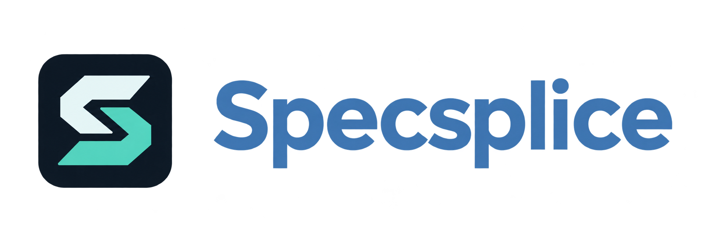
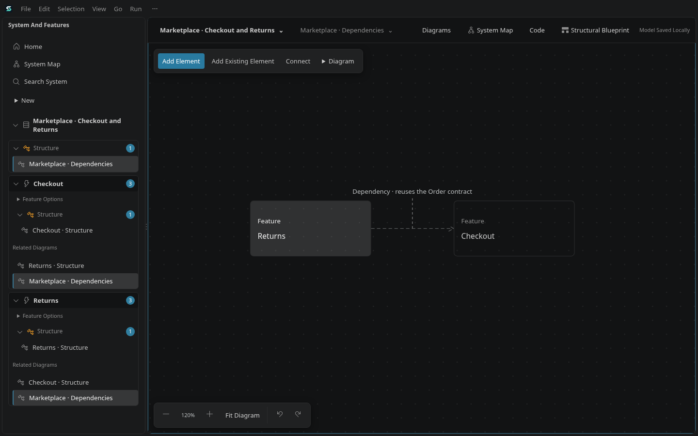

# 

**Open-source desktop IDE for designing software visually and reviewing AI-generated code against acceptance cases.**

Specsplice, formerly Ordito, uses the boundaries, contracts, and behavior you define in a visual model to guide what Codex or Claude Code implements. When the code is ready for review, the same model gives you the context to judge whether it fits the design.

**[Download the desktop preview](#download-the-desktop-preview)** · [Open the browser demo](https://specsplice.pinkbream1027.chatgpt.site/) · [See the Marketplace code review](#marketplace-demo-model-to-reviewed-code) · [Try your first project without an AI account](#try-order-shop-without-an-ai-account)

[](LICENSE.txt)
[](#getting-started)
[](https://github.com/FrappaF/Specsplice/actions/workflows/desktop.yml)

## Download the desktop preview

**Preview 0.1.0, published as Ordito** · [macOS Apple Silicon](https://github.com/FrappaF/Specsplice/releases/download/v0.1.0/Ordito-0.1.0-macos-arm64.zip) · [macOS Intel](https://github.com/FrappaF/Specsplice/releases/download/v0.1.0/Ordito-0.1.0-macos-x64.zip) · [Linux x86-64](https://github.com/FrappaF/Specsplice/releases/download/v0.1.0/Ordito-0.1.0-linux-x64.tar.gz) · [SHA-256 checksums](https://github.com/FrappaF/Specsplice/releases/download/v0.1.0/SHA256SUMS) · [All releases](https://github.com/FrappaF/Specsplice/releases)

- **macOS.** Unzip the archive, move `Ordito.app` to Applications, and open it. The app is ad-hoc signed. macOS may require first-launch approval in **System Settings > Privacy & Security** because the app is currently distributed without Apple notarization.
- **Linux.** Extract the archive and run `./Ordito/ordito` from the extraction directory. The portable app requires a host policy that allows the Electron sandbox.
- **Windows.** [Build and launch from source](#getting-started).

## Try Order Shop without an AI account

1. Extract the [example projects ZIP](https://raw.githubusercontent.com/FrappaF/Specsplice/v0.1.0/ordito/docs/user-guide/example-projects.zip). Keep the hidden `.ordito` folder with each project.
2. In the desktop app, choose **Start a Project > Open Project** and select `Ordito-Example-Projects/01-visual-workshop`. **Checkout Structure** opens in the **Order Shop** project.
3. Select **Confirm Order** in the diagram to inspect its properties. Switch to **Checkout Flow** to follow approved and declined payments. Use **Fit Diagram** if you need to bring the whole view into frame.

This tour requires only the desktop app. To try code review next, use Node.js 24.22.1 and a trusted copy of the Marketplace quantity example to inspect the proposed diff and run 12 independent acceptance cases locally. [Marketplace quantity quickstart](ordito/docs/user-guide/marketplace-quantity-quickstart.md) · [Order Shop tour](ordito/docs/user-guide/README.md#part-i---tour-of-order-shop)

Tell us where you got stuck or what you would try next. Include your OS, Specsplice version, and the step you reached. [Share first-run feedback](https://github.com/FrappaF/Specsplice/issues/35)

## Marketplace demo: model to reviewed code

**Requirements for generation and verification.** Install Node.js 24.22.1 and put it on Specsplice's `PATH` or set `ORDITO_NODE_EXECUTABLE` to its absolute path before launching. Install and authenticate the Codex or Claude Code CLI, connect it from **AI Settings**, and select an available model. Trust your copy of the example folder when Specsplice asks to run the CLI and tests. The framework-free JavaScript example uses local data and simulated payment results. Opening the model requires only Specsplice.

1. Open `Ordito-Example-Projects/07-marketplace-workshop/modules/ai-generation` from the extracted ZIP. In **Checkout · Structure**, **Returns · Structure**, and **Marketplace · Dependencies**, trace how both features use the same `Order` contract.
2. Go to **Code > Prepare Code from Diagrams**. Select **JavaScript · Node.js 24.22.1 · No Framework**, choose **Checkout** and **Returns**, then leave **Independent Verification Cases** blank to use the seven cases bundled with the model. For example, two items at 1,250 cents should total 2,500 cents, and a return qualifies on day 30. Select **Prepare Code Changes** to stage the proposed files.
3. Open **Review AI Code Changes**. Compare the model references and acceptance criteria with the proposed files, then use **Open Diff** to inspect a change. Select **Run Verification** to check the independent cases for each feature. Select **Apply to Project** after verification passes and you approve the changes.




The model capture and the review interface rendered with Marketplace sample data come from the preview released as Ordito 0.1.0. [Follow the full L18 exercise](ordito/docs/user-guide/README.md#l18-generate-code-from-diagrams) · [Connect an AI provider](ordito/docs/user-guide/README.md#connect-a-provider-and-start-generation)

## From architecture to implementation

1. **Design the system in a shared model.** Reuse components and relationships across C4, UML, and entity-relationship diagrams. Define responsibilities, interfaces, and data in the Structural Blueprint and record why you made those choices. When a contract changes, inspect the views and references it affects.
2. **Delegate one feature at a time.** Select the feature and supply independent acceptance cases that capture the outcomes you expect. Specsplice passes the relevant design to the AI and lets you resolve questions about behavior or constraints during generation.
3. **Verify before applying changes.** Inspect the proposed files, diffs, and references to the model in the Code OSS-based IDE. Run your acceptance cases against the generated code, then apply the changes locally when verification passes.

You can also start from an existing codebase. Build a local source inventory, jump from findings to declarations, or ask AI to draft architectural views you can check against the source. On supported profiles, you can simulate interactions, state transitions, and message delivery while refining the design.

## Getting started

Specsplice is in active development. To build it from source, install Git, Python 3, the native build tools for your platform, and the pinned Node.js version. [Build prerequisites](ordito/docs/fork-development.md#from-a-clean-clone) · [Pinned Node.js version](.nvmrc)

### macOS and Linux

With `nvm` installed, run the following commands.

```bash
git clone https://github.com/FrappaF/Specsplice.git
cd Specsplice
nvm install
nvm use
npm run ordito:setup
./ordito/scripts/dev.sh
```

### Windows

After installing the native build tools and selecting the version of Node.js in `.nvmrc`, run the following commands in PowerShell.

```powershell
git clone https://github.com/FrappaF/Specsplice.git
cd Specsplice
npm run ordito:setup
.\scripts\code.bat --user-data-dir .build\ordito-profile --extensions-dir .build\ordito-extensions
```

### Open your own project

From the start screen, choose **Create Project** to design a new system or **Import Codebase** to examine an existing one. Manual modeling and local source inventory work without an AI account. The importer provides built-in semantic resolution for JavaScript, TypeScript, and TSX.

To delegate a feature, connect an authenticated Codex or Claude Code CLI, select a model in Specsplice, and open **Code > Prepare Code from Diagrams**. This workflow currently supports framework-free JavaScript ES modules on Node.js 24.22.1. [Connect a provider](ordito/docs/user-guide/README.md#connect-a-provider-and-start-generation) · [Generate code from diagrams](ordito/docs/user-guide/README.md#l18-generate-code-from-diagrams)

## Documentation

- [User guide](ordito/docs/user-guide/README.md) · [Offline HTML](ordito/docs/user-guide/Specsplice-User-Guide.html) · [PDF](ordito/docs/user-guide/Specsplice-User-Guide.pdf)
- [Atlas of 16 diagrams](ordito/docs/user-guide/README.md#part-iii---atlas-of-16-diagrams)
- [Development guide](ordito/docs/fork-development.md) · [Specsplice architecture](ordito/docs/architecture.md)

## Contributing

Read the contribution guide before reporting a bug, proposing a feature, or submitting a pull request. Use the security policy to report vulnerabilities privately. [Contributing](CONTRIBUTING.md) · [Report an issue](https://github.com/FrappaF/Specsplice/issues) · [Security policy](SECURITY.md)

## License and attribution

Specsplice is licensed under MIT. The recorded upstream revision identifies the Code OSS snapshot used for the fork. [MIT license](LICENSE.txt) · [Code OSS](https://github.com/microsoft/vscode) · [Upstream revision](ordito/upstream.json) · [Third-party notices](ThirdPartyNotices.txt)
