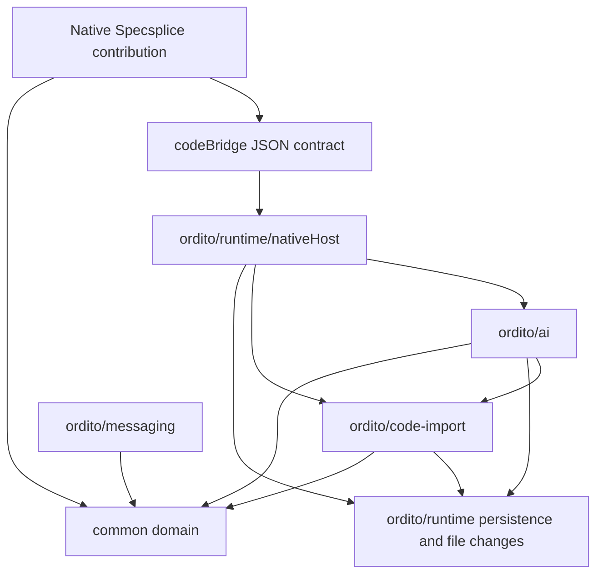

# Specsplice architecture

Specsplice is a Code OSS fork with a native workbench contribution. Start with the [development guide](fork-development.md) to set up a working environment.

## Boundaries and dependencies

The domain lives in `src/vs/workbench/contrib/ordito/common/`. It is pure TypeScript, independent of the filesystem, Node.js, the browser and workbench services. The native contribution adds UI and desktop adapters. The tools in `ordito/` use the same domain.



`ordito/runtime/nativeHost.ts` composes the analysis process. It validates the protocol, coordinates import and AI operations, and keeps a separate cache for each engine instance. The importer is independent of AI and the dispatcher. The shared infrastructure modules `projectStore.ts`, `sourceChanges.ts` and `schemas.ts` are independent of application workflows.

The JSON contract in `common/codeBridge.ts` separates the renderer from the Node.js process. `ordito/runtime/codeProtocol.ts` validates incoming requests. The desktop launches the bundled `orditoCodeEngine.js`. The project format and protocol are independent of how the source files are organized.

## Semantic domain

The model supports legacy formats v2 and v3 and the v4 and v5 contracts. It represents semantic identities, visual projections, source evidence and verification separately. New projects store metadata in `.ordito/`. If a project has metadata only in `.ade/`, Specsplice opens and saves it in place. Existing import snapshots with `model.ade.json` remain readable. Use `.orditoignore` to limit source import. Specsplice reads `.adeignore` if the project has no `.orditoignore`. Architectural ownership comes from model declarations. Evidence from code syntax describes the source, while verification records describe executed behavior.

| Module in `common/` | Responsibility |
| --- | --- |
| `modelTypes.ts` | Document types, category identifiers and declared capabilities. |
| `modelSchema.ts` | Versioned JSON schemas and document shape validation. |
| `modelFoundation.ts` | Empty foundations, object inventory and recognition of evidence models. |
| `modelValidation.ts` | References, properties, diagnostics and reading validated snapshots or inspectable drafts. |
| `modelContractValidation.ts` | Contract compatibility and blueprint constraints. |
| `modelNotation.ts`, `modelScenario.ts` | Notation rules and partial ordering of scenarios. |
| `modelLegacyMigration.ts`, `modelMigration.ts` | Explicit migrations from legacy formats and to the v4 foundation. |
| `semanticModelService.ts` | In-memory model. Document adapters handle persistence. |
| `semanticModel.ts` | Compatibility entry point for the public API. Implementations import directly from the modules that define each API. |

The schema artifacts in `ordito/schema/` are verified against the source. Preserve the document grammar when restructuring code.

## Atomic edits and runtimes

`visualEditTypes.ts` declares the discriminated union of operations. `visualEditing.ts` prepares one candidate and exhaustively dispatches each operation to the relevant handler in `visualEditFoundation.ts`, `visualEditElements.ts`, `visualEditViews.ts` or `visualEditBehavior.ts`. Identities, revisions and validation are handled at the transaction boundary. `visualEditSupport.ts` provides conservative updates and computes dependencies for deletion.

The domain compiles, interprets and verifies interactions, state machines and messaging. Import `interactionRuntime.ts` and `stateRuntime.ts` directly. The modules they depend on avoid re-exporting their generators to prevent dependency cycles.

The scripts `build-interaction-runtime.mjs`, `build-state-runtime.mjs` and `build-messaging-runtime.mjs` share `ordito/runtime/runtimeSource.ts`. This module uses the TypeScript parser to find declarations by name, reports missing or ambiguous declarations and generates JavaScript. Generation is independent of comment headings and function order. Regenerate `*.generated.ts` artifacts with their scripts. A compatibility test pins the hashes of the three generated interpreters because managed regions in projects require an exact runtime match.

## Native workbench contribution

`browser/ordito.contribution.ts` registers the editor, views and commands. `OrditoProjectService` uses native text services to manage the document. These adapters handle saving, backups, conflicts and history. Navigation, layout, selection and model analysis use pure domain functions.

| Component | Responsibility |
| --- | --- |
| `OrditoEditor` | Editor lifecycle, composition and navigation. |
| `OrditoCanvasController` | Camera, zoom, pan, node movement and listeners scoped to each render. |
| `OrditoCanvasSurface` | Canvas rendering, menus and connection creation. |
| `OrditoInspector` | Properties for the selected elements and relationships. |
| `OrditoWorkflowContent` | Workflow panels, AI settings and secondary tools. |

The controller registers its listeners in a `DisposableStore`, clears the store on each subsequent render and disposes it with the editor. Each notation has its own renderer module. Components receive their services and callbacks explicitly and are independent of the editor class.

`orditoEditingCommands.ts` defines the edit command catalog. `orditoEditing.ts` tracks the document revision and controls when edits are applied. The handlers `orditoEditingProject.ts`, `orditoEditingSpecification.ts`, `orditoEditingStructure.ts` and `orditoEditingDiagram.ts` collect user intentions through dialogs. When adding a command, extend the typed dispatch to cover it.

## AI workflows

`electron-browser/orditoAiService.ts` coordinates independent components.

| Component | Responsibility |
| --- | --- |
| `OrditoAiConnection` | Provider account, original CLI, models and configuration. |
| `OrditoAiDiagrams` | Diagram conversation, exploration, generation and review. |
| `OrditoAiStructural` | Continuous preparation, structural review, simulation and publishing. |
| `OrditoAiImplementation` | Implementation proposals, reconciliation, verification and model comparisons. |

Each component owns its workflow sessions and resources. The coordinator shares the operation lock, cancellation, progress and notifications through a context that exposes the capabilities each workflow needs. Execution options select the AI, diagram or local mode. Constructors receive the required services. The instantiation service is used only during initial composition.

Each workflow prepares changes for review and provides a way to apply them. Its contract covers budget, consent to share context, verification, recovery and undo. The [user guide](user-guide/README.md) explains how to import, generate and verify from the interface.

## Testing and maintenance

The independent Node.js packages are `ordito/runtime`, `ordito/code-import`, `ordito/ai` and `ordito/messaging`. Each has pinned dependencies and TypeScript checks. `ordito/tsconfig.tools.json` defines shared options and keeps AI configuration independent of the importer. Domain tests live in `ordito/test/`, and native contribution tests live in `src/vs/workbench/contrib/ordito/test/`.

To work on the tools alone, select the Node.js version in `.nvmrc` and install the packages you need.

```sh
npm --prefix ordito/runtime ci --ignore-scripts
npm --prefix ordito/code-import ci --ignore-scripts
npm --prefix ordito/ai ci --ignore-scripts
npm --prefix ordito/messaging ci --ignore-scripts
npm run ordito:test
npm --prefix ordito/runtime run check
npm --prefix ordito/runtime test
npm --prefix ordito/code-import run check
npm --prefix ordito/code-import test
npm --prefix ordito/ai run check
npm --prefix ordito/ai test
```

The architecture tests check for runtime dependency cycles, verify that the domain and importer are independent, and ensure that desktop scenarios can resolve shared names. The suite also checks that runtime generation is independent of comments and declaration order.

For the native contribution, complete setup in the [development guide](fork-development.md), then use `npm run ordito:check`, `npm run ordito:smoke:check`, the client build required by your test and `npm run ordito:ai:service-test`. Run the desktop smoke tests through `ordito/scripts/smoke-desktop.mjs`. Launch, isolation and error collection live in `ordito/scripts/smoke/harness.ts`, shared interactions in `helpers.ts` and scenarios in their own modules.

`ordito/prototype/` preserves the original prototype and compatibility tests. The native app has its own launcher.
