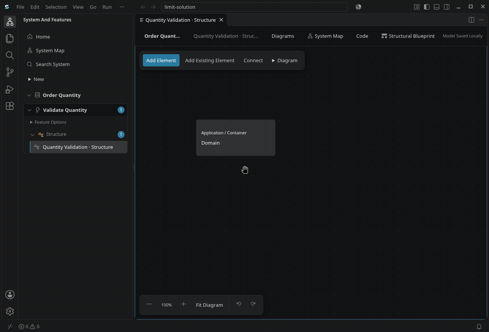

# Verify Marketplace's quantity limit without an AI account

Marketplace accepts whole-number order quantities from 1 through 10. Open the completed model, inspect the JavaScript and tests Specsplice stages from it, then run the independent acceptance cases before applying the files. This exercise runs locally with zero AI calls.

Try six input cases first to see what the rule accepts. [Open the Marketplace browser demo](https://specsplice.pinkbream1027.chatgpt.site/marketplace/)

## Set up the example

These steps use preview 0.1.0, published under the former name Ordito.

1. Download the Linux x86-64, macOS Apple Silicon, or macOS Intel archive and follow the release's first-launch instructions. [Preview 0.1.0 downloads and checksums](https://github.com/FrappaF/Specsplice/releases/tag/v0.1.0)
2. Install Node.js 24.22.1 and select it in your terminal. `node --version` must print `v24.22.1`. Launch the preview from that terminal so its verification runner can use the same Node executable. [Node.js 24.22.1 downloads](https://nodejs.org/en/download/archive/v24.22.1)
3. Extract the example ZIP to a writable location and keep the hidden `.ordito` folder. The project to open is `Ordito-Example-Projects/07-marketplace-workshop/modules/quantity/limit-solution`. [Example projects for preview 0.1.0](https://raw.githubusercontent.com/FrappaF/Specsplice/v0.1.0/ordito/docs/user-guide/example-projects.zip)

For the Linux archive, run this from the directory containing the extracted `Ordito` folder.

```sh
ORDITO_NODE_EXECUTABLE="$(node -p 'process.execPath')" ./Ordito/ordito
```

For macOS, run this after moving `Ordito.app` to Applications and approving first launch if prompted.

```sh
ORDITO_NODE_EXECUTABLE="$(node -p 'process.execPath')" /Applications/Ordito.app/Contents/MacOS/Ordito
```

If the desktop app is already running, quit it before relaunching. The explicit path selects the correct runtime when several Node versions are installed.

## Review, verify, and apply

1. In **Start a Project > Open Project**, select `limit-solution`. The **Order Quantity** project opens on **Quantity Validation · Structure**. If the app asks for workspace trust, check that it names your extracted copy before choosing **Trust Folder & Continue**. Local verification needs permission to execute the generated checks.
2. Open **Code > Review and Verification > Prepare Model to Code Review**. **Reviewed Behavior** shows `quantity > 0` and `quantity ≤ 10`. **Planned Changes** lists a JavaScript module, its test file, `package.json`, and `.gitignore`.
3. Expand **Technical Details** and choose **Open File Differences and Technical Context**. Select the generated `src/predicate-….mjs` diff tab to read the implementation and the `test/predicate-….test.mjs` tab to inspect the independent expectations. Return to the project tab for the review.
4. Select **Run Real Verification** and confirm local execution. The review should show **Real Verification Passed · Ready to Apply Locally** with **12 Derived Cases · 12 Independent Cases**. Expand **Verification Output** to inspect the results.
5. Choose **Apply to Project** and confirm. After **Applied Locally**, open the generated files through **Files** to see them in your project. To restore the working copy, reopen **Code > Review Changes** if needed, choose **Undo Local Changes**, and confirm. **Local Changes Undone** confirms the undo. The model and its independent cases are still available for another review.

## What you should see

The cases include both range boundaries. The rule rejects 0 and 11 and accepts 1 and 10. The text input `two` produces an input type error. Specsplice compares the emitted behavior with the expected results shipped in `.ordito/criteria.json` and reports **Zero AI Calls**.



The 29-second recording shows the quantity model, the review preparation, and the local verification result in the Linux preview released as Ordito 0.1.0.

Try the exercise with your own proposed boundary in a fresh copy of the project. The full L12 lesson shows how to edit the predicate and set the expected cases. [Full Marketplace L12 lesson](README.md#l12-implement-and-verify-the-quantity-limit)

Which part of the workflow would you use in your own project? If you got stuck, share your OS, Specsplice version, and the last screen you reached. [Share first-run feedback](https://github.com/FrappaF/Specsplice/issues/35)
